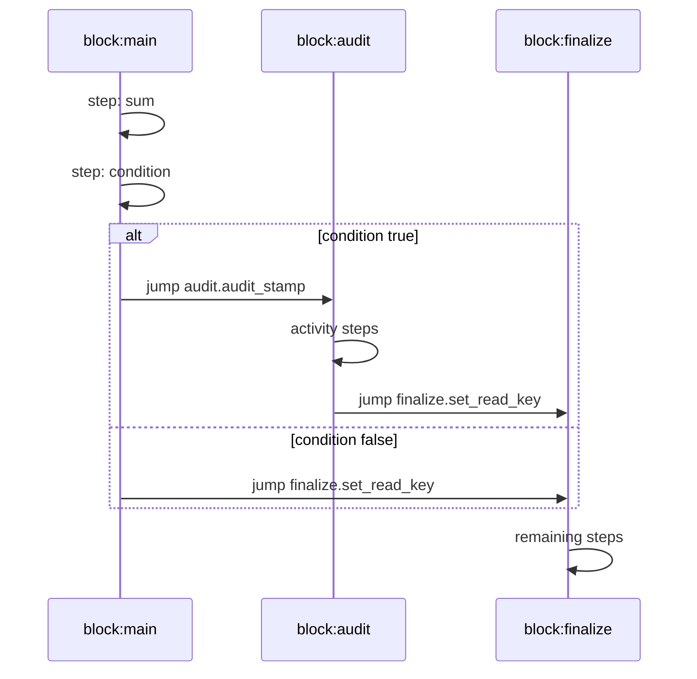

# Flow, Blocks, and Steps

## Model

A flow is defined as `flow -> blocks -> steps`.

- Blocks are named execution sections.
- Steps execute in order unless control transfer occurs (`call`, `jump`, `pause`).
- Step ids are unique per block.

## Step Behavior Summary

A step runs its keys in this order:

1. `condition`: gate; a false result skips the rest of the step (including `call`).
2. `context`: merge literal values into shared context.
3. `call`: run another block from a step, then return into this step.
4. `activity`: invoke callable and store result under step id key.
5. `jump`: transfer control to another block/step without returning.
6. `pause`: persist state and stop execution; resume continues after this step.

Blocks do not fall through: the flow ends when the running block finishes.

## Call and Jump Rules

- `call` keeps a return frame (calling block and step) in `_flow_stack` while the called block runs.
- A `jump` restarts the nearest invocation that is running the target block. If no invocation runs it, the target becomes the running block and pending call continuations are dropped.
- A pause inside a called block keeps the frames in `_flow_stack`; on resume the called block finishes and control returns into the calling step.
- Calls nest up to `_max_call_depth` (default 256).

## Control Transfer Example

